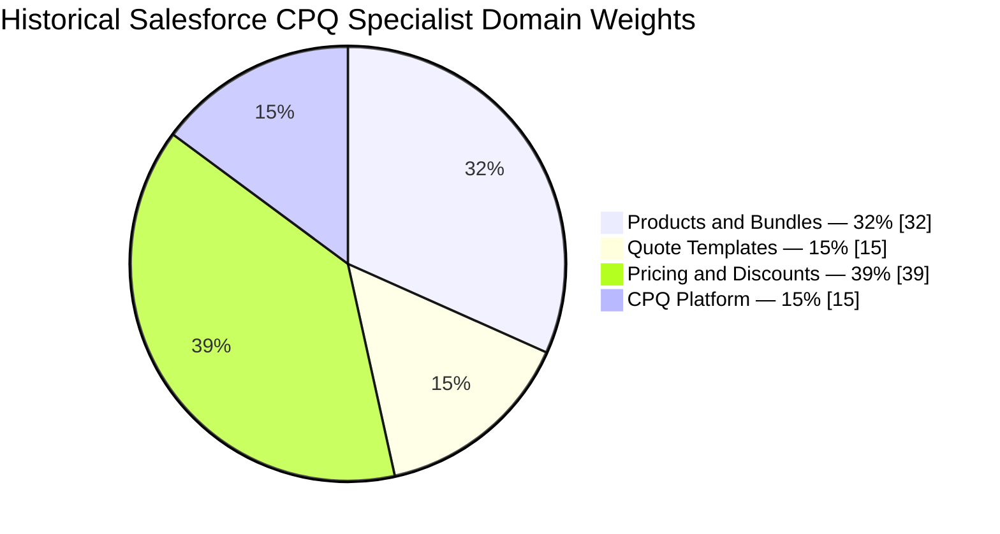
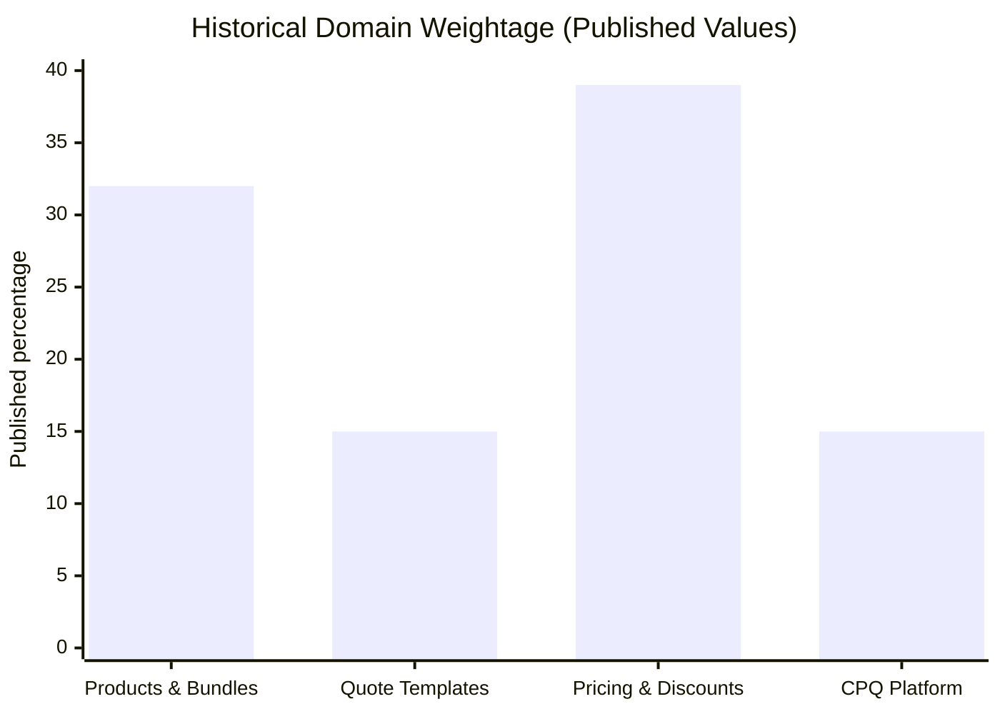
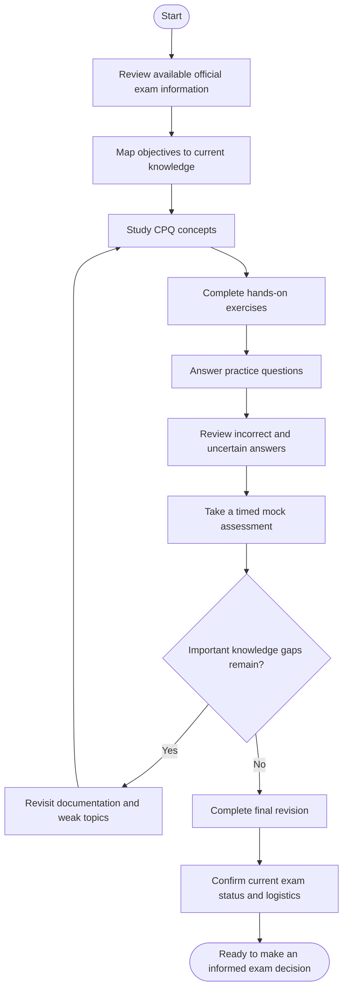
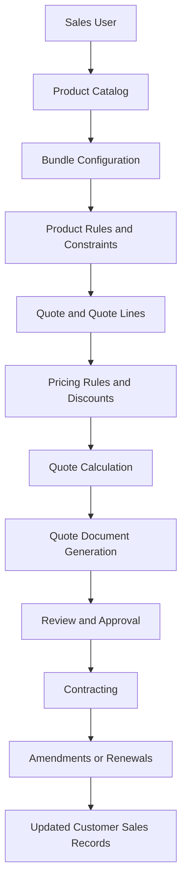
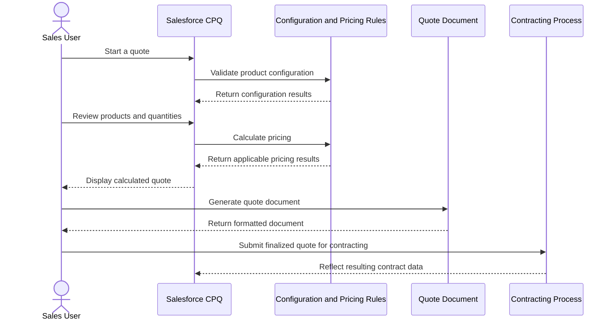
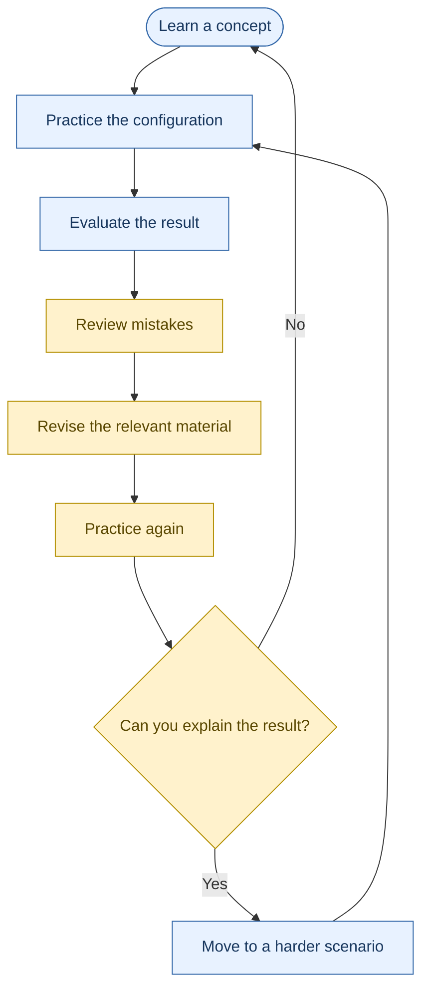
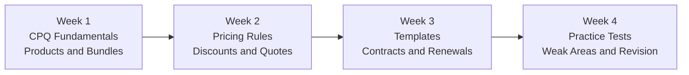

# Salesforce Certified CPQ Specialist — Study Guide

A practical learning resource for understanding Salesforce Configure, Price, Quote (CPQ), from product bundles and pricing rules to quote documents, contracting, amendments, and renewals.

This repository brings together exam-preparation guidance, technical diagrams, hands-on project ideas, original practice questions, and links to official Salesforce learning resources.

> **Important:** The publicly available Salesforce Certified CPQ Specialist exam guide is dated Winter ’19. Its objectives and exam statistics are historical reference material, not confirmation of the current exam blueprint or registration availability. Check the [Salesforce certification catalog](https://trailheadacademy.salesforce.com/) before planning an exam attempt.

**Supplementary preparation:** [CertsGate Salesforce certification resources](https://certsgate.com/exams/salesforce)

---

## Table of Contents

- [Overview](#overview)
- [About the Credential](#about-the-credential)
- [Who Should Use This Guide?](#who-should-use-this-guide)
- [Core Salesforce CPQ Concepts](#core-salesforce-cpq-concepts)
- [Historical Exam Objectives](#historical-exam-objectives)
- [Historical Domain Weightage](#historical-domain-weightage)
- [Certification Preparation Flowchart](#certification-preparation-flowchart)
- [Conceptual CPQ Architecture](#conceptual-cpq-architecture)
- [Quote-to-Contract Sequence](#quote-to-contract-sequence)
- [Circular Study and Revision Cycle](#circular-study-and-revision-cycle)
- [Step-by-Step Study Guide](#step-by-step-study-guide)
- [Four-Week Study Roadmap](#four-week-study-roadmap)
- [Hands-On Practice Projects](#hands-on-practice-projects)
- [Original Practice Questions](#original-practice-questions)
- [How to Review Mistakes](#how-to-review-mistakes)
- [Common Preparation Mistakes](#common-preparation-mistakes)
- [Career Relevance](#career-relevance)
- [Frequently Asked Questions](#frequently-asked-questions)
- [Official and Additional Resources](#official-and-additional-resources)
- [About CertsGate](#about-certsgate)

---

## Overview

Salesforce CPQ helps sales teams configure products, calculate prices, prepare quotes, and manage important steps in the quote-to-cash process. A well-designed CPQ implementation connects product rules, pricing logic, quote documents, and downstream contracting activities.

Preparing for a Salesforce CPQ Specialist certification requires more than memorizing terminology. You should be able to interpret a business requirement, select an appropriate configuration, predict the result, and troubleshoot unexpected behavior.

This guide focuses on five practical learning goals:

- Understand how products, bundles, features, and options work together.
- Configure pricing methods, discounts, and price rules.
- Generate quote documents that reflect business requirements.
- Understand contracts, amendments, and renewals.
- Investigate configuration, calculation, access, and process issues.

The topics below are based on the historical Salesforce CPQ Specialist exam guide and general CPQ learning recommendations. Verify current certification requirements independently before scheduling an exam.

## About the Credential

The historical Salesforce Certified CPQ Specialist credential was intended for people with experience designing, building, and implementing quoting processes using Salesforce CPQ. The Winter ’19 exam guide describes a target audience that includes IT professionals, sales operations staff, technical architects, and implementation consultants.

The guide recommended practical CPQ experience alongside independent study and formal training.

| Detail | Historical reference |
|---|---|
| Credential name | Salesforce Certified CPQ Specialist |
| Provider | Salesforce |
| Product area | Configure, Price, Quote (CPQ) |
| Historical exam guide | Winter ’19 |
| Prerequisite listed in that guide | None required |
| Historical question format | Multiple-choice and multiple-select |
| Historical duration | 105 minutes |
| Historical passing score | 68% |

These exam details come from the older [Salesforce CPQ Specialist Exam Guide](https://developer.salesforce.com/resources2/certification-site/files/SGCertifiedCPQSpecialist.pdf). They should not be treated as current exam policies.

## Who Should Use This Guide?

This repository may be useful for:

- Salesforce administrators learning CPQ configuration.
- CPQ consultants preparing to implement quoting workflows.
- Sales operations professionals who work with product catalogs and quote processes.
- Salesforce professionals troubleshooting pricing and product configuration.
- Learners who want to connect CPQ concepts with realistic business scenarios.

Basic familiarity with Salesforce records, fields, objects, permissions, and sales processes will make the material easier to follow.

If you are new to Salesforce CPQ, begin with the fundamentals and practice in an appropriate sandbox or training environment before attempting complex configuration scenarios.

---

## Core Salesforce CPQ Concepts

### 1. Products and Bundles

A product represents something a business sells. A bundle groups related products and lets users select compatible options according to business rules.

Learn the difference between:

- Products and product options.
- Features and configuration attributes.
- Product rules and option constraints.
- Guided selling and product search filters.
- Subscription products and assets.

**Example:** A company sells a software package with a required core license, optional analytics, and an optional support plan. The configuration should prevent users from selecting incompatible options while allowing valid combinations.

### 2. Pricing and Discounts

CPQ pricing can involve list prices, contracted prices, discount schedules, price rules, and other pricing methods.

Study how pricing requirements influence configuration. When a calculated price is unexpected, investigate the inputs and applicable rules rather than changing values without understanding the calculation.

Important concepts include:

- Price rules and price actions.
- Discount schedules.
- Contracted prices.
- Price dimensions and subscription terms.
- The price waterfall.
- Calculation behavior and rule evaluation.

### 3. Quote Templates

Quote templates control how quote information appears in generated documents.

Learn how template sections, line columns, quote terms, and document requirements work together. When a document displays incorrect or missing information, trace the issue to the source data and the relevant template configuration.

### 4. Contracts, Amendments, and Renewals

Contracting and subscription changes connect quotes to longer-term customer relationships.

Practice explaining what happens when a finalized quote is contracted, when an existing subscription is amended, and when a customer renews a contract. The exact result depends on the product setup, quote data, and configured business process.

### 5. Platform Configuration and Troubleshooting

A CPQ implementation also depends on Salesforce platform configuration.

Review:

- Object relationships and CPQ data flow.
- Package-level settings.
- User permissions and record access.
- Page layouts and interface configuration.
- Approval processes.
- Localization and translated values.
- Troubleshooting amendment and renewal behavior.

---

## Historical Exam Objectives

The Winter ’19 Salesforce CPQ Specialist exam guide identifies four domains. The list below summarizes the published scope rather than claiming to represent a current exam blueprint.

| Domain | Main areas to study |
|---|---|
| Products and Bundles | Bundle design, product rules, option constraints, configuration attributes, guided selling, subscription products |
| Quote Templates | Template structure, document output, quote terms, line item sections, troubleshooting rendered documents |
| Pricing and Discounts | Pricing methods, price rules, discount schedules, price dimensions, contracted prices, calculation troubleshooting |
| CPQ Platform | Data flow, user interface, permissions, contracting, amendments, renewals, localization |

For the detailed historical objectives, consult the [official Salesforce CPQ Specialist PDF](https://developer.salesforce.com/resources2/certification-site/files/SGCertifiedCPQSpecialist.pdf).

## Historical Domain Weightage

The historical guide publishes the following percentages. They total **101%**, so the source figures appear inconsistent with a 100% distribution. The values below are reproduced as published rather than silently adjusted. Confirm the current blueprint with Salesforce before using these numbers to prioritize exam study.

### Published percentages

### Domain comparison

Pricing and Discounts has the largest published value in this historical guide, followed by Products and Bundles. That makes both useful areas for in-depth technical practice, but current official objectives should take priority if they differ.

---

## Certification Preparation Flowchart

Use this workflow to turn exam objectives into practical skills. The readiness decision is based on whether you can explain and apply the concepts, not simply whether you recognize familiar answer choices.

If you cannot explain why a configuration works, return to the relevant concept and test it again in a sandbox.

## Conceptual CPQ Architecture

The following is an illustrative view of a typical CPQ quoting workflow. It is a learning diagram, not an official Salesforce architecture specification. The exact implementation depends on the org, installed products, and business requirements.

### How to read the diagram

- **Product Catalog:** supplies products and their selling information.
- **Bundle Configuration:** helps users select products that meet customer needs.
- **Rules and Constraints:** enforce applicable configuration requirements.
- **Quote and Pricing:** bring selected products, quantities, and pricing logic together.
- **Document Generation:** presents quote details in a customer-facing format.
- **Contracting and Renewals:** support later stages of the customer agreement lifecycle.

Use this model to explain where a problem may originate. For example, an incorrect quote total may come from product configuration, rule inputs, discount logic, or calculation behavior.

## Quote-to-Contract Sequence

A sequence diagram helps clarify the order of activities and the questions you should ask when troubleshooting.

This is a conceptual sequence. Actual automation, integrations, approvals, and contracting behavior vary by implementation.

## Circular Study and Revision Cycle

CPQ preparation works best as an iterative process. Every practice attempt should reveal something you can improve.

Repeat the cycle until you can explain both the configuration and the reasoning behind its outcome.

---

## Step-by-Step Study Guide

### Step 1: Confirm the Current Certification Information

Start with the Salesforce certification catalog and the official exam guide, if one is currently published for your target credential.

Check the credential name, registration availability, exam version, objectives, delivery options, and any current requirements. Do not assume that a historical guide is still the active blueprint.

### Step 2: Build a CPQ Fundamentals Checklist

Before studying advanced scenarios, make sure you can explain:

- How products and price books relate to selling products.
- How bundles, features, and options work together.
- How product rules differ from pricing rules.
- How quote lines and pricing calculations interact.
- How quote templates produce customer-facing documents.
- How contracting, amendments, and renewals affect the sales process.

Write a short explanation for each item in your own words.

### Step 3: Practice Product Configuration

Create a sample product catalog in a training environment where possible.

Build a bundle with required and optional products. Add a rule that prevents an invalid combination, then test both valid and invalid selections.

Record what happened and why. This exercise develops the habit of linking configuration settings to business requirements.

### Step 4: Investigate Pricing Behavior

Create a small set of products with different pricing requirements.

Test a basic price, a discount, a customer-specific price, and a rule-driven adjustment where supported by your environment. Compare expected and actual results.

When the numbers differ, trace the inputs and rule logic systematically.

### Step 5: Generate and Review Quote Documents

Create a sample quote and generate its document.

Check whether the required quote terms, product details, line columns, and sections appear as expected. If something is missing, identify whether the issue relates to the data, template structure, or configuration.

### Step 6: Study Contracting and Subscription Changes

Use a sample scenario to reason through the lifecycle of a finalized quote, a subsequent amendment, and a renewal.

Be able to explain what information changes, which records or processes are involved, and what should be checked when the expected result does not occur.

### Step 7: Test Your Knowledge

Use original practice questions, knowledge checks, and mock assessments to identify gaps. After each attempt, connect every mistake to a concept or objective and return to the relevant learning material.

[CertsGate Salesforce preparation resources](https://certsgate.com/exams/salesforce) can be used as supplementary practice alongside official documentation and hands-on work.

---

## Four-Week Study Roadmap

This is an independent example schedule, not an official Salesforce time requirement. Adjust it to your experience, available study time, and the current exam objectives.

| Week | Focus | Practical outcome |
|---|---|---|
| 1 | CPQ terminology, product catalog, bundles, features, options, product rules | Build and test a valid bundle |
| 2 | Pricing methods, price rules, discount schedules, quote calculations | Explain the price of a sample quote |
| 3 | Quote templates, permissions, contracting, amendments, renewals | Complete a sample quote-to-contract walkthrough |
| 4 | Practice questions, troubleshooting, mock assessment, final revision | Identify remaining gaps and review them |

### Suggested weekly routine

1. Review one topic and its documentation.
2. Apply the concept in a suitable environment.
3. Answer a small set of relevant practice questions.
4. Record incorrect answers and uncertain reasoning.
5. Revisit the material and repeat the exercise.

A shorter, consistent routine with meaningful review is more useful than rushing through a large number of questions without understanding the answers.

---

## Hands-On Practice Projects

These independent projects help connect CPQ theory to realistic business requirements. They are not official exam tasks.

### Project 1: Configurable Software Package

**Scenario:** A business sells a base software license with optional analytics and premium support.

Tasks:

- Create a sample product catalog.
- Configure a bundle and its selectable options.
- Define a business rule that prevents an invalid configuration.
- Test valid and invalid combinations.
- Document the expected result.

**Learning goal:** Understand how bundle design, product rules, and option constraints support a selling process.

### Project 2: Discount and Pricing Investigation

**Scenario:** A customer receives a volume-based discount, but the calculated total does not match the expected result.

Tasks:

- Document the list price, quantity, and expected discount.
- Inspect the applicable pricing configuration.
- Compare expected and calculated values.
- Identify which rule or input explains the difference.
- Record the resolution and a regression test.

**Learning goal:** Develop a structured approach to pricing troubleshooting.

### Project 3: Quote Document Review

**Scenario:** A generated quote must include selected products, line details, and customer terms.

Tasks:

- Create a sample quote.
- Generate the document with the available template configuration.
- Check the output against a simple requirements checklist.
- Investigate missing or incorrectly displayed information.
- Repeat the test after the change.

**Learning goal:** Connect quote data, template settings, and document output.

### Project 4: Subscription Lifecycle

**Scenario:** A customer purchases a subscription and later requests a change before renewal.

Tasks:

- Map the original quote and contract process.
- Explain the intended amendment.
- Describe the renewal scenario.
- Identify which records and calculations should be checked.
- Write down possible causes if the resulting data is unexpected.

**Learning goal:** Understand the relationship between quoting, contracting, amendments, and renewals.

---

## Original Practice Questions

The questions below are written for this repository as learning exercises. They are not official, leaked, or reproduced Salesforce exam questions.

### Question 1: Bundle Configuration

A company sells a base product and an optional add-on. The add-on must be unavailable unless the base product is selected. Which area should you investigate first?

A. Quote template sections  
B. Product configuration rules or option constraints  
C. User localization settings  
D. Contract renewal dates  

**Answer: B**

**Explanation:** The requirement concerns which product combinations are valid. Product rules or option constraints are the relevant areas to investigate, depending on the exact configuration.

### Question 2: Unexpected Pricing

A quote displays a total that differs from the amount expected by the sales team. What is the most useful first step?

A. Change the final total manually without investigating  
B. Remove every price rule  
C. Trace the product, quantity, pricing inputs, and applicable calculation logic  
D. Replace the quote template  

**Answer: C**

**Explanation:** Start by understanding the inputs and calculation path. A template change usually affects presentation rather than the underlying price calculation.

### Question 3: Incorrect Quote Document

A quote calculates correctly, but a required term is missing from the generated document. Which area is the most relevant starting point?

A. Quote template configuration and the source of the term  
B. Product option constraints  
C. Discount schedule tiers  
D. Product search filters  

**Answer: A**

**Explanation:** Check whether the term exists in the source data and whether the template is configured to display it.

### Question 4: Unexpected Amendment Result

An amendment produces unexpected subscription information. What should you do?

A. Assume the original contract is irrelevant  
B. Investigate the amendment inputs, existing subscription data, and configured process  
C. Change user language settings first  
D. Rebuild all product bundles immediately  

**Answer: B**

**Explanation:** Amendment behavior depends on the starting data and the configured lifecycle process. Trace those elements before changing the implementation.

### Question 5: Effective Practice

You repeatedly answer questions about price rules incorrectly. What is the best next step?

A. Memorize the answer letters  
B. Skip pricing because another topic feels easier  
C. Review the relevant concepts, test a pricing scenario, and explain the result  
D. Take more mock tests without reviewing the mistakes  

**Answer: C**

**Explanation:** Targeted review combined with practical testing helps uncover misunderstandings that repeated guessing can hide.

---

## How to Review Mistakes

A practice score is only useful when it helps you improve.

Use this review process after every question set:

1. **Answer:** Select an answer and record your reasoning.
2. **Review:** Check the explanation or documentation.
3. **Understand:** Explain why the correct option fits the requirement.
4. **Identify the weak area:** Connect the mistake to a CPQ concept or objective.
5. **Revisit the material:** Study the relevant documentation and test the concept.
6. **Try again:** Use a new scenario to check whether the knowledge has improved.

Keep a simple error log:

| Topic | Mistake | Likely cause | Next action |
|---|---|---|---|
| Product rules | Confused a configuration requirement with a pricing requirement | Concepts overlap in the scenario | Compare the purpose of each rule type and test both |
| Pricing | Could not explain the calculated total | Did not trace inputs and rule behavior | Recreate the scenario and inspect the calculation |
| Quote templates | Missed a required field in the output | Did not verify the source and template | Test the field and document configuration |
| Renewals | Misunderstood the resulting subscription data | Limited lifecycle practice | Walk through the example from original contract to renewal |

Review uncertain answers too. A correct guess can still indicate a knowledge gap.

## Common Preparation Mistakes

- **Relying on an old exam outline without checking its status.** The historical guide is useful for learning CPQ concepts, but it may not describe a currently available exam.
- **Memorizing question answers.** Learn the technical reasoning so you can handle different scenarios.
- **Ignoring hands-on practice.** Reading about bundles and pricing is not the same as configuring and testing them.
- **Changing settings without a hypothesis.** Identify the expected behavior and investigate the relevant inputs before modifying configuration.
- **Skipping quote document testing.** A correct calculation does not automatically guarantee a correct customer-facing document.
- **Neglecting contracts and renewals.** Learn how the lifecycle connects to the original quote.
- **Treating one mock-test score as proof of readiness.** Look for consistent understanding across topics and the ability to explain why alternatives are unsuitable.

---

## Career Relevance

Salesforce CPQ knowledge can be relevant to work involving sales operations, Salesforce administration, quote-to-cash processes, and CPQ implementation consulting.

The concepts in this guide also help professionals communicate more clearly with sales teams, business analysts, and technical stakeholders. For example, a consultant who can explain why a product configuration is invalid or why a quote total differs from expectations can investigate requirements more effectively.

A credential may help demonstrate structured learning, but employment outcomes depend on experience, practical ability, role requirements, and other qualifications. Certification alone does not guarantee a job or promotion.

## Frequently Asked Questions

### What is Salesforce CPQ?

Salesforce CPQ stands for Configure, Price, Quote. It supports product configuration, pricing, and quote preparation as part of a sales process.

### Is the Salesforce CPQ Specialist exam guide current?

The publicly available Salesforce CPQ Specialist PDF linked in this repository is dated Winter ’19. Treat its exam details and domain weights as historical. Verify the current credential and exam information through Salesforce before registering.

### What were the historical Salesforce CPQ Specialist exam details?

The Winter ’19 guide lists 60 multiple-choice/multiple-select questions, 105 minutes, and a 68% passing score. These figures are historical and should not be assumed to apply to any current exam.

### What should I study first?

Begin with product catalogs, bundles, product rules, and basic pricing. Then work through quote documents, platform configuration, contracting, amendments, and renewals. Confirm the current official objectives before setting your final priorities.

### Are hands-on labs necessary?

Practical exercises are strongly recommended as a learning approach. They help you understand how configuration choices affect product selection, pricing, quote output, and lifecycle processes.

### Can practice questions replace official documentation?

No. Use questions to test your understanding and locate weak areas. Use official documentation and practical exercises to learn the concepts behind the answers.

### Where can I find supplementary practice materials?

You can browse [CertsGate Salesforce certification resources](https://certsgate.com/exams/salesforce) for additional study and practice material. Treat third-party content as supplementary and verify technical or exam-policy details against Salesforce sources.

### Does completing this guide guarantee a passing result?

No. This repository is a learning aid, not a guarantee of exam success. Readiness depends on the current exam requirements, your understanding, and your ability to apply the relevant concepts.

---

## Official and Additional Learning Resources

Use official sources first for certification requirements and product behavior.

### Salesforce resources

- [Salesforce Certified CPQ Specialist Exam Guide — historical Winter ’19 PDF](https://developer.salesforce.com/resources2/certification-site/files/SGCertifiedCPQSpecialist.pdf)  
  The published historical objectives, audience description, recommended training, and exam details.

- [Salesforce Trailhead](https://trailhead.salesforce.com/)  
  Guided learning modules and product education.

- [Salesforce CPQ Specialist preparation Trailmix](https://trailhead.salesforce.com/users/amanj/trailmixes/cpq-cert-prep)  
  A Salesforce-hosted learning collection that references exam-guide review and CPQ learning activities. Check the availability and currency of individual items.

- [Salesforce CPQ Administrator preparation Trailmix](https://trailhead.salesforce.com/users/strailhead/trailmixes/prepare-for-your-salesforce-cpq-specialist-credential)  
  A related CPQ learning collection. Its current contents and credential alignment should be verified before use.

- [Salesforce Help](https://help.salesforce.com/)  
  Product documentation and support material. Search for the specific CPQ feature you are studying.

- [Salesforce certification catalog](https://trailheadacademy.salesforce.com/)  
  Check current credential availability, exam information, and official learning paths.

### Supplementary practice

- [CertsGate — Salesforce certification preparation](https://certsgate.com/exams/salesforce)  
  An independent source of additional certification-preparation material. Use it to supplement, not replace, official documentation and hands-on practice.

---

## About CertsGate

[CertsGate](https://certsgate.com/) provides independent IT certification preparation resources. Learners may use relevant study guides, practice questions, and mock-test materials to reinforce concepts, assess understanding, and identify topics that need further review.

For Salesforce-related preparation, browse the [CertsGate Salesforce exam catalog](https://certsgate.com/exams/salesforce). Cross-check exam objectives, product behavior, and certification policies against current official Salesforce information.

CertsGate is referenced here as a supplementary learning resource. This repository does not claim that CertsGate is an official Salesforce certification provider or partner.

